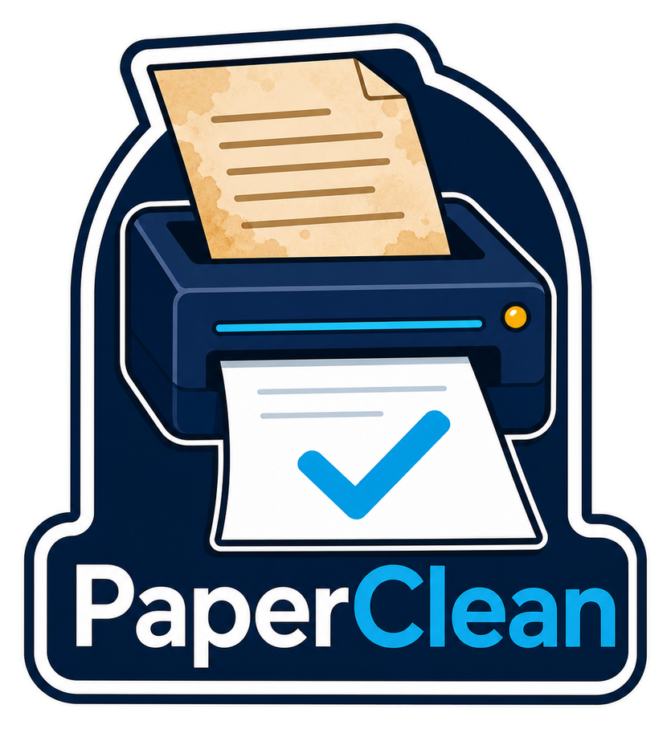
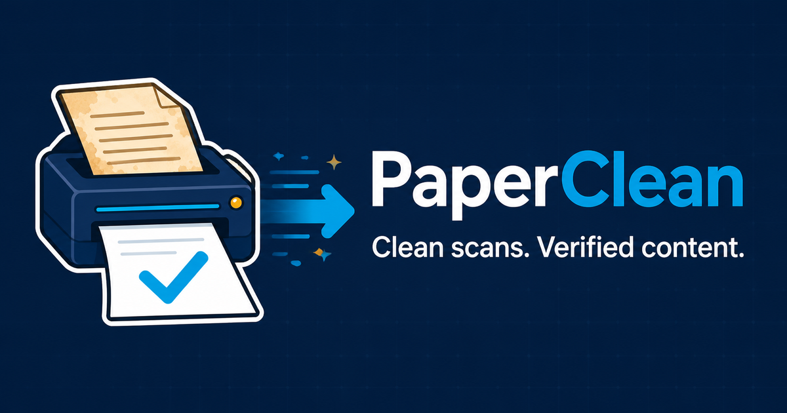

<p align="center">
  
  <br />
  <!-- repo-tagline:start -->
  <strong>🧹 Clean scans. Verified content 🧹</strong>
  <!-- repo-tagline:end -->
</p>

PaperClean Web cleans document photos and scans, verifies that page content
was preserved, and keeps the original when verification fails.

## Try it

Open [PaperClean](https://paperclean.tsilva.eu) to see the upload flow. To try
it locally without sending a document to a provider, run from the checkout:

```bash
pnpm install --frozen-lockfile
pnpm preview:local --port auto
```

Open the printed URL. Real conversion requires a configured processor. Review
the maximum charge before confirming a real job.

[](https://paperclean.tsilva.eu)

[PaperClean Web development and deployment](docs/paperclean-web-guide.md).
